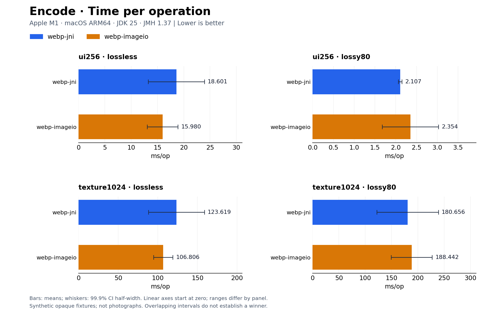
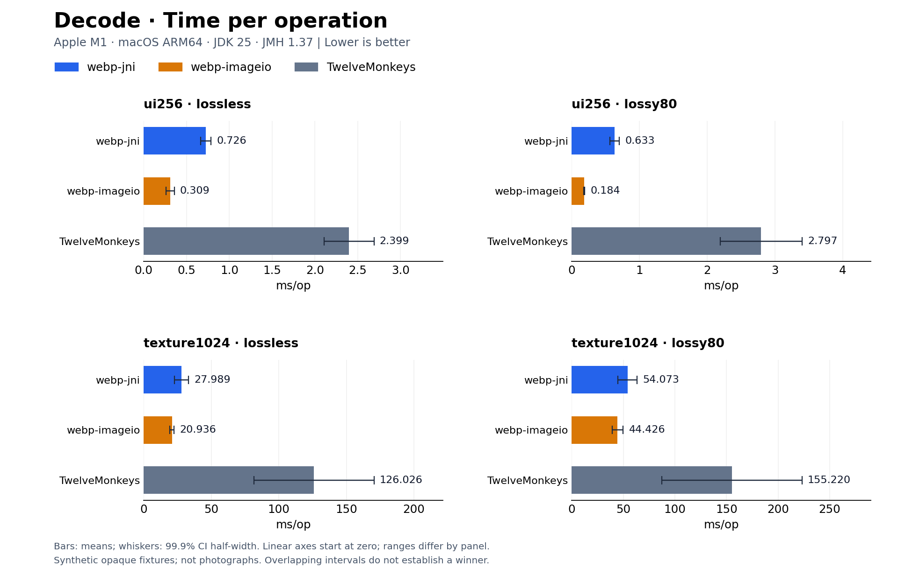
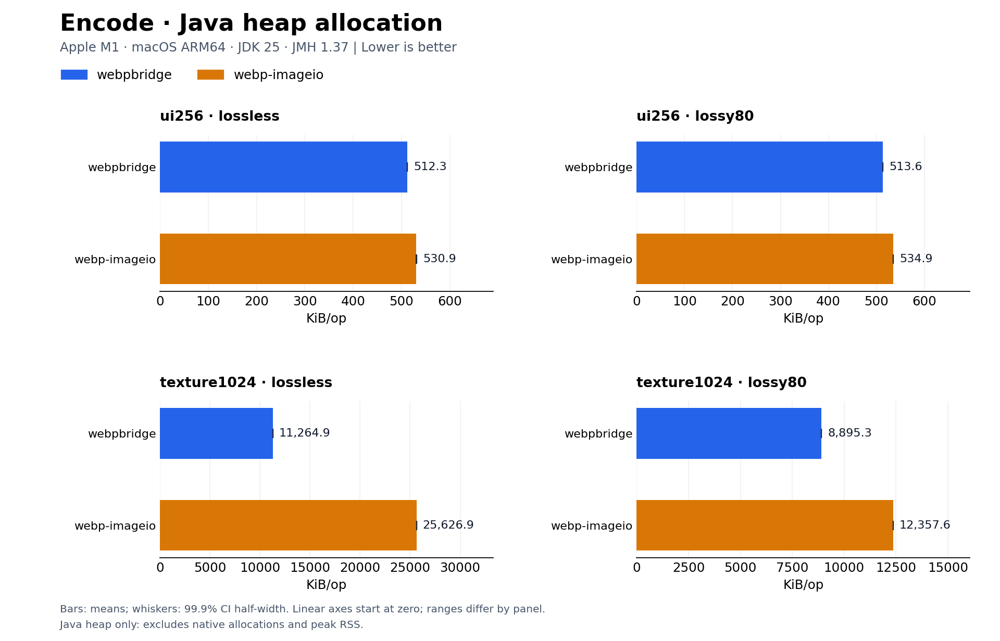
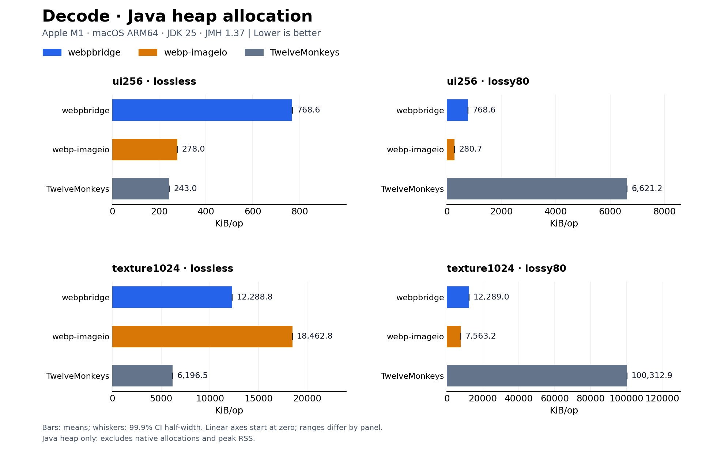

# webpbridge

A Java 17+ WebP API for server-side image workflows: explicit resource limits, header inspection, predictable file/stream ownership, and native runtime diagnostics. Encoding and decoding use Google's libwebp through JNI, without an external conversion process.

```java
import io.github.prismpx.webpbridge.WebP;

byte[] compressed = WebP.encode(image, 80f);
byte[] lossless = WebP.encodeLossless(image);
BufferedImage restored = WebP.decode(compressed);
// Optional limit checked before allocating native decoded pixels:
BufferedImage limited = WebP.decode(compressed, 4_000_000);
```

## Server-side API

```java
import io.github.prismpx.webpbridge.WebP;
import io.github.prismpx.webpbridge.WebPInfo;
import io.github.prismpx.webpbridge.WebPOptions;

WebPOptions options = WebPOptions.builder()
    .quality(80)
    .maxPixels(4_000_000)
    .maxInputBytes(8 * 1024 * 1024)
    .build();

WebPInfo info = WebP.inspect(uploadBytes, options);
if (info.animated() || info.pixelCount() > options.maxPixels()) {
    throw new IllegalArgumentException("Unsupported upload dimensions or animation");
}
BufferedImage image = WebP.decode(uploadBytes, options);
byte[] compressed = WebP.encode(image, options);
```

`inspect` reports width, height, alpha, animation and compression format from the container header without decoding a pixel buffer. It still receives/buffers the encoded input and does **not** establish that the complete pixel bitstream is valid. Animated headers can be inspected, but animation decoding remains unsupported. Inspection applies the byte limit, not the pixel limit, so applications can examine dimensions before choosing whether to decode. Inspection accepts the same containers as decoding: a complete RIFF payload (bytes after it are ignored) or a raw VP8/VP8L bitstream. Any input that `decode` accepts is accepted by `inspect` with the same dimensions.

Decoded images are `TYPE_INT_ARGB` when the bitstream has alpha and `TYPE_INT_RGB` otherwise, so opaque results can be written directly as JPEG with `ImageIO`.

### Options and limits

`WebPOptions` is immutable and shareable; builders create independent snapshots. Defaults are quality 80, lossy encoding, 16 million pixels and 64 MiB encoded input. Quality controls lossy quality or lossless compression effort; set `.lossless(true)` for exact lossless output, including RGB under fully transparent pixels.

- `encode(image, options)` checks source pixels before allocating pixel copies.
- `decode(bytes, options)` checks encoded bytes and decoded pixels.
- `read` and `inspect` bound input bytes as they read, including streams with unknown length. Oversize input is rejected with `IllegalArgumentException`; determining excess can consume one byte beyond the configured limit.
- These limits are **not a total-memory budget**. Java/native copies and temporary allocations are additional. I/O and native calls have no timeout, forced cancellation, or streaming-pixel guarantee.
- Existing `encode(image, quality)`, `encodeLossless(image)` and `decode(bytes[, maxPixels])` retain their prior behavior. Legacy encoders do not gain the new option-based source-pixel limit; legacy decoders do not gain an encoded-byte limit. Use the option overloads for bounded service inputs.

### Files and caller-owned streams

```java
BufferedImage image = WebP.read(inputPath, options);
WebP.write(image, newOutputPath, options); // CREATE_NEW; does not overwrite
WebPInfo info = WebP.inspect(inputPath, options);

BufferedImage uploaded = WebP.read(inputStream, options);
WebP.write(uploaded, outputStream, options);
```

Path operations open/close their own streams. Caller-provided streams are **never closed or automatically flushed**; the caller owns their lifetime. All encoded input/output is buffered in memory. Encoding finishes before any output is touched. Validation/encoding failures therefore leave output untouched, while an I/O failure can leave partial stream data or a partial newly created file. Existing destination files are never overwritten. Filesystem/stream errors remain `IOException`; input/limit errors remain `IllegalArgumentException`.

### Startup diagnostics

```java
var runtime = WebP.runtimeInfo();
if (!runtime.available()) {
    throw new IllegalStateException(runtime.failureReason());
}
System.out.println(runtime.platform());
System.out.println(runtime.bundledPlatforms());
System.out.println(runtime.encoderVersion());
System.out.println(runtime.decoderVersion());
```

The first call attempts native loading and returns a cached immutable diagnostic snapshot, including load failures. Versions come from the loaded native codec; bundled platforms describe resources actually present in the JAR, not a blanket support claim. Set `webp.jni.path` before any native use. Failed native class initialization requires a fresh class loader or JVM; diagnostics do not retry or repair loading. Operationally, this supports startup checks without exposing `UnsatisfiedLinkError` from the diagnostic query itself.

## Benchmarks

Measured on **Apple M1 (ARM64), macOS 26.4.1, Azul OpenJDK 25.0.3**, on 2026-11-01, using JMH 1.37. Compared against [webp-imageio 0.11.0](https://github.com/usefulness/webp-imageio) and [TwelveMonkeys 3.15.3](https://github.com/haraldk/TwelveMonkeys). TwelveMonkeys supports WebP decoding only. Both native implementations used libwebp 1.6.0; the competitor's version was queried from its bundled native binary.

Two synthetic opaque fixtures: a 256×256 UI-like grid (`ui256`) and 1024×1024 seeded uniform random RGB (`texture1024`, **not a photograph**). Encoding matches quality/effort (lossless 75 or lossy 80), method 4, exact RGB, no encoder threading and no sharp YUV. Decoders receive identical WebP bytes. Timing covers full in-memory API calls, including conversion/copies and ImageIO object/stream creation and disposal; initialization and disk I/O are excluded. Decode outputs retain each API's raster layout. These results predate the copy-free pixel path in [#12](https://github.com/prismpx/webpbridge/issues/12), which removed about two thirds of webpbridge's Java heap allocation per decode; the charts have not been regenerated yet.

### Performance at a glance

Lower bars mean less time or fewer Java heap allocations per operation. Whiskers show 99.9% confidence-interval half-widths. Every panel uses a linear axis starting at zero, with its own range; compare implementations **within** a panel.





<details>
<summary>Java heap allocation comparisons (excludes native memory and peak RSS)</summary>





</details>

The recorded measurements predate the `webp-jni` → `webpbridge` rename. Display labels use the current name; raw results retain the original names and unchanged measured values.

<!-- BEGIN BENCHMARK TABLES -->
Average **ms/op ± JMH 99.9% confidence-interval half-width**; lower is better. Each cell contains 10 measured iterations across two forks.

### Encoding

| Dataset | Mode | webpbridge | webp-imageio 0.11.0 |
| --- | --- | ---: | ---: |
| ui256 | lossless | 18.601 ± 5.336 | 15.980 ± 2.920 |
| ui256 | lossy80 | 2.107 ± 0.043 | 2.354 ± 0.676 |
| texture1024 | lossless | 123.619 ± 35.200 | 106.806 ± 12.183 |
| texture1024 | lossy80 | 180.656 ± 58.595 | 188.442 ± 38.856 |

### Decoding

| Dataset | Mode | webpbridge | webp-imageio 0.11.0 | TwelveMonkeys 3.15.3 |
| --- | --- | ---: | ---: | ---: |
| ui256 | lossless | 0.726 ± 0.062 | 0.309 ± 0.048 | 2.399 ± 0.290 |
| ui256 | lossy80 | 0.633 ± 0.067 | 0.184 ± 0.005 | 2.797 ± 0.604 |
| texture1024 | lossless | 27.989 ± 5.221 | 20.936 ± 1.488 | 126.026 ± 44.346 |
| texture1024 | lossy80 | 54.073 ± 9.175 | 44.426 ± 5.373 | 155.220 ± 67.877 |

### Java heap allocation

Measured **KiB/op** (`gc.alloc.rate.norm` / 1024). These are Java allocations, **not native memory or peak RSS**. See raw JSON for allocation confidence intervals.

| Dataset | Mode | Encode JNI | Encode ImageIO | Decode JNI | Decode ImageIO | Decode TwelveMonkeys |
| --- | --- | ---: | ---: | ---: | ---: | ---: |
| ui256 | lossless | 512.3 | 530.9 | 768.6 | 278.0 | 243.0 |
| ui256 | lossy80 | 513.6 | 534.9 | 768.6 | 280.7 | 6621.2 |
| texture1024 | lossless | 11264.9 | 25626.9 | 12288.8 | 18462.8 | 6196.5 |
| texture1024 | lossy80 | 8895.3 | 12357.6 | 12289.0 | 7563.2 | 100312.9 |

### Encoded output sizes

Both native encoders produced byte-identical output for every fixture in this run; [SHA-256 checksums](benchmarks/results/output-sizes.csv) are retained.

| Dataset | Mode | webpbridge bytes | webp-imageio bytes |
| --- | --- | ---: | ---: |
| ui256 | lossless | 134 | 134 |
| ui256 | lossy80 | 1,536 | 1,536 |
| texture1024 | lossless | 3,145,808 | 3,145,808 |
| texture1024 | lossy80 | 719,014 | 719,014 |
<!-- END BENCHMARK TABLES -->

In this run, native ImageIO had lower mean decode times than this binding in all four cases; the UI cases have non-overlapping error intervals. This binding decoded faster than TwelveMonkeys for these fixtures. All four encoding comparisons have overlapping error intervals, so they do not establish an encoding winner.

These results describe these workloads on one shared desktop, not a universal ranking or a production SLA. Small differences with overlapping error intervals are inconclusive. No claim is made about real photographs, alpha-heavy images, concurrent throughput, cold starts, or other platforms. Native memory and leak checks are covered separately under extended validation.

[Methodology and reproduction commands](benchmarks/README.md) · [JMH raw results](benchmarks/results/macos-arm64-jdk25.json) · [Environment](benchmarks/results/environment.json). Benchmark dependencies are isolated in the standalone `benchmarks` module. CI validates correctness and runs only a smoke benchmark; its timings are not used in the tables. Regenerate tables with `python3 benchmarks/report.py` after reproducing the recorded run configuration.

## Build

Requires JDK 17+, Maven, CMake 3.20+, Git and a C compiler. Set `JAVA_HOME` to your JDK. CMake downloads pinned libwebp v1.6.0 and statically links it into the JNI library; no system libwebp installation is required.

```sh
cmake -S . -B build -DCMAKE_BUILD_TYPE=Release
cmake --build build --config Release --parallel
cmake --install build --config Release --prefix target/classes --component webpjni
mvn verify
```

The resulting `target/webpbridge-0.1.0-SNAPSHOT.jar` contains the native library for **the build machine's OS/CPU only** and libwebp license notices. Run `mvn install` to use that local artifact from another Maven project:

```xml
<dependency>
  <groupId>io.github.prismpx</groupId>
  <artifactId>webpbridge</artifactId>
  <version>0.1.0-SNAPSHOT</version>
</dependency>
```

This artifact is not yet published to Maven Central. Development CI uploads separate platform JARs. The release workflow builds one multi-platform JAR containing Linux x86-64, Windows x86-64 and macOS ARM64 natives, and validates that same JAR on all three systems with Java 17 and 25. See [release instructions and prerequisites](docs/releasing.md); a successful unsigned candidate build does not mean the artifact has been published. `mvn clean` removes the installed native resource: repeat the CMake install step afterward.

## Example

After building, convert a PNG or JPEG to lossless WebP:

```sh
java -cp target/webpbridge-0.1.0-SNAPSHOT.jar examples/Convert.java input.png output.webp
```

## Native loading

The loader selects `/native/<os>-<arch>/<library>` from the JAR, extracts it into a private temporary directory, then loads it. Supported platform names are linux, macos and windows; architectures x86_64 and aarch64. Support requires building and testing for the actual target; Linux binaries depend on the build system's libc. Alternatively set `-Dwebp.jni.path=/absolute/path/to/library` to load an explicitly built JNI library. An executable temporary filesystem is required for bundled loading. Each process holds a lock on its extraction directory. On load, `webpbridge-*` directories left by processes that have exited (Windows cannot delete a loaded DLL at shutdown) are removed on a best-effort basis; directories still locked by a running JVM, recently created ones, symbolic links and directories containing anything other than the extracted library are left alone, and cleanup failures never affect loading. On recent JDKs, use `--enable-native-access=ALL-UNNAMED` when required by the runtime.

## Behavior and limits

- Lossy quality is a finite number from 0 to 100. Alpha is preserved.
- Lossless encoding uses `exact=1`, preserving RGB even under fully transparent pixels.
- Images are normalized to 8-bit sRGB ARGB. `TYPE_INT_ARGB` and `TYPE_INT_RGB` images (including subimages) are copied from their raster without color conversion; other types go through `BufferedImage.getRGB`. Both paths produce identical output. Source metadata, ICC profiles and high bit depth are not preserved.
- Animation is rejected. This is not an ImageIO plugin.
- Default decoding limit: 16 million pixels. Override via `decode(bytes, maxPixels)`.
- Invalid input/options produce `IllegalArgumentException`; native encoding failures produce `IllegalStateException`; missing binaries produce `UnsatisfiedLinkError`.
- Calls use independent native state and can run concurrently. Each call copies pixel data; account for Java and native memory in addition to the pixel limit. Decoding allocates the returned image's `int[]` (4 bytes/pixel) plus a temporary native buffer of the same size; encoding allocates one `int[]` copy plus libwebp's picture and working memory. No streaming, cancellation or decode timeout is provided.

## License

Java/JNI wrapper: MIT. Bundled libwebp: upstream BSD-style license and patent grant, copied into `META-INF/licenses/libwebp` during the native install step. See [libwebp](https://github.com/webmproject/libwebp).

## Extended validation

After the native install step, `mvn -Pstress test` runs 4096×4096 lossy/lossless round trips and two concurrent 2048×2048 lossless round trips with JNI checks and a 2 GiB Java heap limit. It checks every lossless pixel and every lossy alpha value, default decode-limit rejection above 16 million pixels, and successful decoding with an explicit larger limit. Test timeouts are failure detection, not interruption of an in-flight native codec. Run this suite in a process with an external time limit on CI. Measurements are workload-specific, not a throughput or peak-memory guarantee.

### Memory diagnostics

The stress profile also runs 2,000 real-JVM encode/decode cycles with valid inputs and rejection paths. A separate native harness exercises the actual JNI C entry points through a small array/exception adapter, including simulated JNI pin and output-allocation failures. This enables ASan/UBSan and, on Linux, LeakSanitizer without suppressing JVM runtime allocations:

```sh
cmake -S . -B build-sanitize -DCMAKE_BUILD_TYPE=RelWithDebInfo -DWEBP_JNI_NATIVE_TESTS=ON -DWEBP_JNI_SANITIZERS=ON
cmake --build build-sanitize --target jni_memory_test --parallel
ASAN_OPTIONS=detect_leaks=1:halt_on_error=1 UBSAN_OPTIONS=halt_on_error=1 ctest --test-dir build-sanitize --output-on-failure -V
```

Use Linux for leak detection. Apple ASan requires `detect_leaks=0`; that run checks memory access and undefined behavior but does not establish leak freedom. The standalone adapter does not model the entire JVM or force failures inside every libwebp allocation. The real-JVM soak validates integration but is not itself a native leak detector. See [validation results](docs/validation.md).

The default suite includes deterministic malformed-input and dimension-boundary checks; `mvn -Dtest=MalformedInputTest test` runs them separately. A mutation may remain a valid image: the check requires a bounded valid result or the documented input exception, rather than requiring every mutation to fail. This is not coverage-guided fuzzing.

`mvn -Pinterop test` requires `cwebp` and `dwebp` on PATH (for example, the `webp` package on Ubuntu). It verifies both directions with independent CLI tools. Grayscale PNG readers can differ in sample-to-sRGB interpretation: pixel equality against a source image uses explicit 8-bit sRGB normalization, while native grayscale input is compared against an independent decode of the same WebP. The default suite also covers 11 Java image types and subimages.

`mvn verify` additionally runs five packaged-JAR integration tests in fresh JVMs: bundled native loading, explicit path loading, missing native resource diagnostics, invalid explicit path failure, and repeated unavailable-runtime diagnostics. It exercises paths containing spaces and checks the classes came from the built JAR. CI uploads test reports alongside each platform artifact. The runner's actual OS/architecture is printed in the integration-test report; the matrix is not a claim that every OS/architecture or libc combination is supported.
